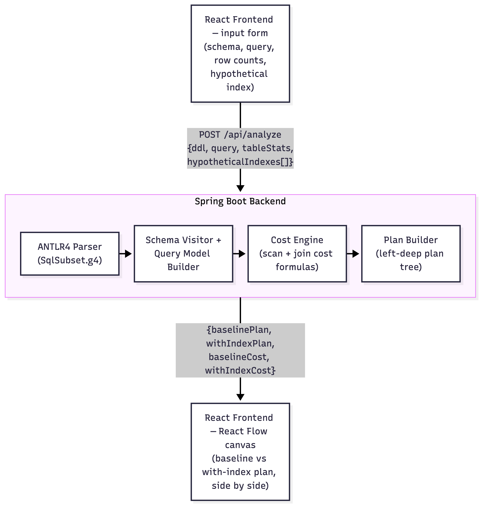
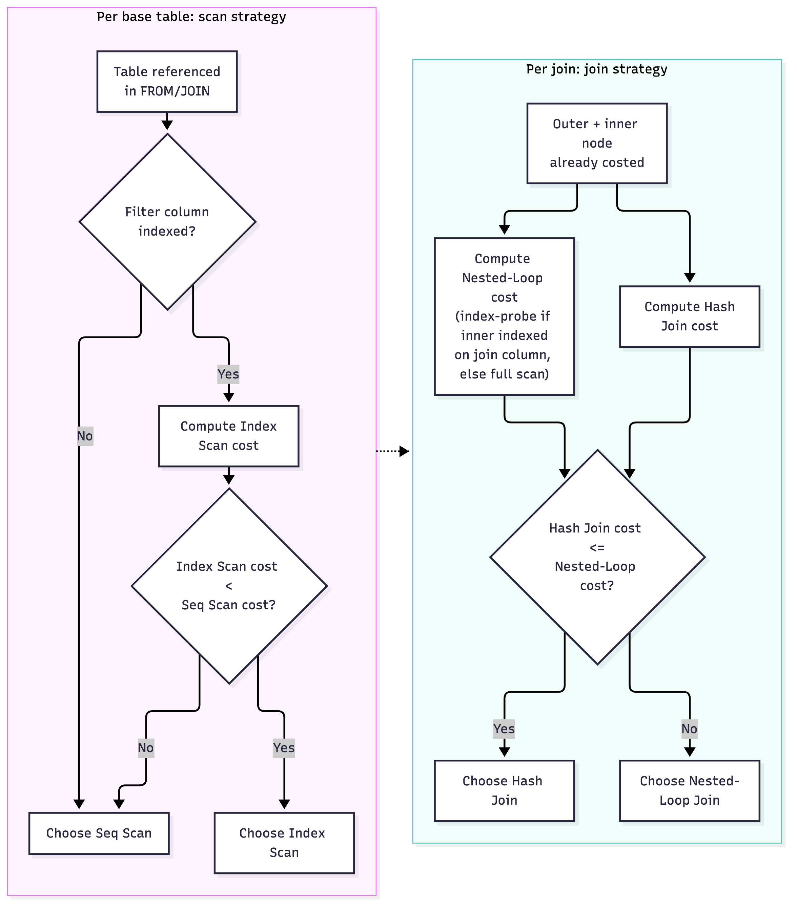
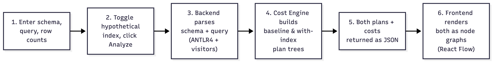
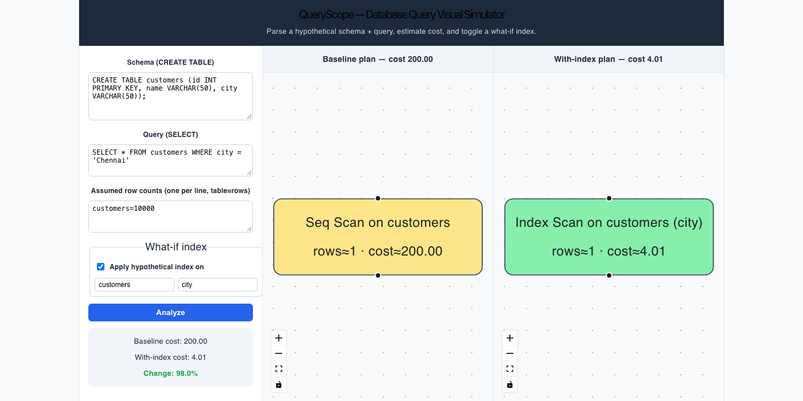
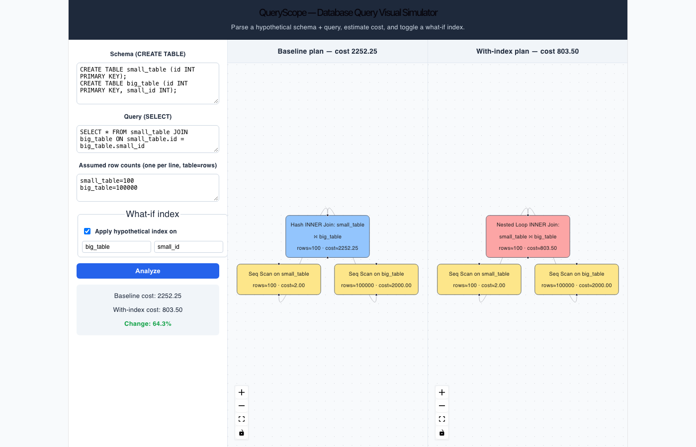
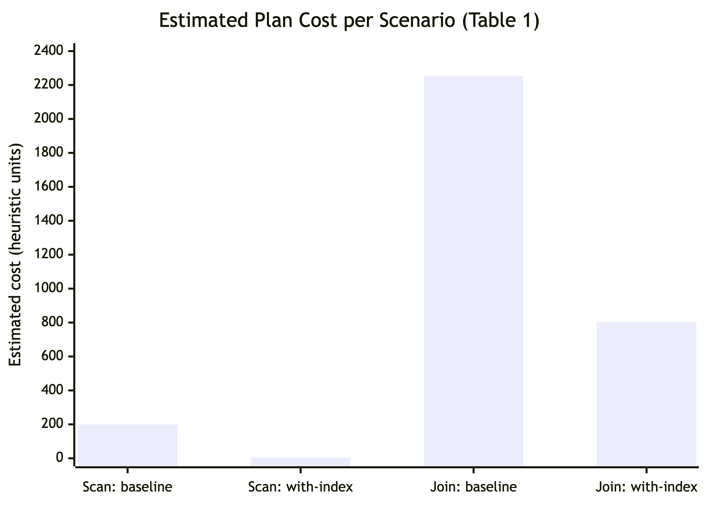

# Database Query Visual Simulator: An Interactive What-If Sandbox for SQL Query Cost Explanation

**Joel Devasia, Divyaraj and Alen Varghese Soji \***
School of Computer Science and Engineering, Vellore Institute of Technology, Vellore, Tamil Nadu, India
Email: joel.devasia2023@vitstudent.ac.in
Email: divyaraj.2023@vitstudent.ac.in
Email: alenvarghese.soji2023@vitstudent.ac.in
\*Corresponding author

## Abstract

Writing SQL is easy. Understanding why it runs slowly is not. Students, junior developers, and even experienced DBAs regularly hit a wall here, because the standard tool for the job, EXPLAIN, just dumps a block of operator names and cost numbers with no context and nothing visual. Testing a fix isn't much easier either, since you don't want to be adding a new index to a live production database just to see what happens. A lot of prior work sidesteps this problem instead of solving it directly. Indexing, partitioning, and query rewriting are well-understood but still have to be applied by hand; newer ML and reinforcement-learning optimizers do better on raw performance but give that up in exchange for transparency, and they need training data and live statistics that simply aren't available early in a project. What we present here is the Database Query Visual Simulator: a web tool that takes a raw SQL query and a hypothetical schema, parses them with ANTLR4, estimates cost using a PostgreSQL-style heuristic model running in a Java backend, and draws the resulting execution plan as an interactive graph. Toggle a hypothetical index on any column and the estimated cost updates immediately, with no live database and no real data needed. What you end up with is a small, honest sandbox, something a student can use to see how query planning works, and something a DBA can use to sanity-check an indexing idea before going anywhere near a real system.

## Keywords

SQL Query Optimization, Query Execution Plan Visualization, Cost-Based Query Optimization, What-If Index Analysis, ANTLR-Based SQL Parsing, Interactive Node-Graph Visualization, Database Explainability

## 1. Introduction

Most data-heavy applications still run on relational databases, and how fast they feel usually comes down to how well their SQL performs, and that's been true for decades; it just matters more now that "a lot of data" means millions or billions of rows instead of thousands. A query doesn't run exactly as written. It first passes through a query optimizer, which has to decide, quickly, which of many possible ways of fetching the data will be cheapest: sequential scan or index scan, nested-loop join or hash join or merge join, and once you're past two tables, which order to join them in. The optimizer scores each option with a cost model built from estimated row counts, selectivity, and I/O and CPU overhead, and picks whatever comes out cheapest. This isn't a small detail. A good plan can be an order of magnitude faster than a bad one, and at scale that's the gap between a query that returns instantly and one that stalls the whole application. It's why query optimization has stayed an active research area for so long, and why it keeps pulling in new heuristic, cost-based, and now machine-learning approaches [1]–[10].

None of this reasoning is visible to the people who need it. When a developer or DBA is asked why a query is slow, the standard response is to run EXPLAIN and read its output. What comes back is a wall of operator names, cost estimates, and row-count guesses, nested to mirror the plan's branching, in plain text with no visual structure at all. Even a fairly ordinary query, two or three joins and a filter, can produce an EXPLAIN block dozens of lines long, and reading it correctly means already knowing the optimizer's thinking beforehand: which operations are expensive, why one join order won out over another, and what those cost numbers even mean relative to each other. That's exactly the knowledge a beginner doesn't have yet. So the one tool meant to explain the optimizer's reasoning only really makes sense to someone who's already internalized that reasoning.

Testing a fix is awkward even for people who do understand it. Checking whether an index would help usually means one of two things: running EXPLAIN against a large real dataset, which takes setup time and isn't something most teams let a junior developer do on shared or production infrastructure, or estimating the effect by hand, working out how many rows a filter would cut, whether the planner would even pick up a new index, how much it would save. There's no way to check that hand estimate against anything. Both routes are slow, and the manual one is easy to get wrong, because selectivity and cardinality estimation is exactly the kind of fiddly, detail-heavy math a database engine is built to do and a person isn't. In practice, a lot of indexing decisions come down to gut feeling and trial and error more than anything resembling analysis.

Existing research covers pieces of this problem, but not the specific gap we're after. Heuristic techniques, multi-level indexing, partitioning, sharding, caching, query rewriting, materialized views, are still the backbone of practical tuning, and they're well documented as effective [1], [2], [4]. These are the tools a working DBA reaches for, understood well precisely because they've been used and studied for so long. Meanwhile, over the last few years a lot of new work has leaned into machine learning and reinforcement learning: cost models and rewrite strategies learned from historical workloads, with real reported performance gains but also real costs in training overhead and integration difficulty [3], [6], [9], [10]. These approaches offer an adaptability static heuristics can't match. An ML-based optimizer can, at least in theory, notice a workload behaving unusually and adjust, but that comes at the price of needing data and infrastructure a small team or early-stage project usually doesn't have lying around. A smaller strand of work looks at the mechanics of plan search itself rather than any one technique: how algebraic and physical optimization interact [5], and, closer to what this project builds on, how what-if cost analysis can decide whether a hypothetical index is worth creating before you build it [8]. Across either camp, though, none of it gives a non-expert something to look at and explore. It's a number or a paragraph, not an interactive view of a plan.

That's the gap we're aiming at. Query optimization doesn't have to live only in prose and numbers. Which scan method, which join, which index would help and by how much, that's fundamentally a graph-shaped decision, a tree of operations feeding into each other, each one with its own cost, and graphs are things people can explore visually in a way a page of EXPLAIN output just can't be. Turn the execution plan into an interactive graph, let someone flip a hypothetical index on and off and watch the cost move in response, and a student can finally see what a textbook only describes in the abstract: why a hash join beat a nested loop, why indexing one column reshapes the whole plan while indexing another does nothing at all. A junior developer can reason about a slow query without learning EXPLAIN syntax first. A DBA or backend engineer can sanity-check an indexing call, or explain one to a teammate, without going near a production database or waiting on a maintenance window to test a hunch.

This tool serves dual purposes in both educational settings and day-to-day professional work, with its applications reinforcing one another. As an instructional aid, it transforms an abstract concept like query planning, normally just a lecture slide with a cost formula on it, into a hands-on exercise students can manipulate and watch respond. As a diagnostic tool, it becomes one of the first things a developer reaches for when a query is slow and nobody has the time or appetite to spin up production data just to test a theory. And as a communication tool, it gives a DBA an effective way to show a team why a proposed schema or indexing change would (or wouldn't) help, before anyone commits to building it, sharing a picture instead of a paragraph only the author fully understands.

Because we're aiming for a focused, buildable MVP rather than a full database engine, the scope here is deliberately narrow, and each boundary is a specific call about where the value is highest for the effort it costs. In scope: parsing standard SELECT statements with INNER/LEFT/RIGHT JOIN, WHERE, and ORDER BY from raw CREATE TABLE and query input, since that covers most of what a student or junior developer runs into early on; user-supplied row-count assumptions instead of real data, so the tool never needs a live database; a Java cost engine running baseline PostgreSQL-style heuristic formulas, chosen because Postgres's cost model is open, documented, and widely taught; and an interactive node-graph with what-if index toggles, which is the actual novel piece relative to what's already out there. Out of scope: live database connections (which would bring back exactly the risk this project is trying to avoid); advanced SQL, window functions, CTEs, subqueries, GROUP BY, which would complicate the parser and cost model a lot for not much teaching value at this stage; and dialects other than PostgreSQL, since supporting several cost models would multiply the work without changing the core idea. These boundaries keep the system's behavior fully explainable, which is the whole point, at the cost of not covering every SQL feature or matching production-grade accuracy, a trade we're making on purpose.

### 1.1 Objectives

1. To study existing approaches to SQL query optimization, traditional techniques like indexing, partitioning, and query rewriting, and newer ML/RL/AI-based methods, and see how each one communicates cost to the people relying on it.
2. To identify the limitations of current SQL optimization and tuning tools, particularly the lack of interactive, explainable execution-plan visualization and the inability to safely test a hypothetical index without a real database.
3. To design and build a web-based query simulator that parses raw SQL and schema input, estimates cost with a transparent heuristic model, and shows the result as an interactive graph.
4. To enable safe what-if analysis by letting a user toggle an index on a column and see the difference between baseline and simulated cost.

## 2. Literature Review

SQL query optimization matters because the same query can run in many different ways at very different costs. Early work in this area was about choosing between execution plans using statistics, heuristics, indexing, join ordering, and cost-based estimation. As workloads have grown bigger and messier, static techniques on their own have started showing their limits, part of why adaptive, ML-based, and hybrid approaches have become such an active research area.

Current best practices remain largely rooted in traditional optimization methods. A study by Rahman et al. [1] demonstrated that integrating multi-level indexing, query rewriting, and dynamic execution plans can significantly reduce both retrieval and execution time compared to using any single technique in isolation. Similarly, Uzzaman et al. [2]'s research on large-scale SQL workloads found that effective tuning depends on the specific workload, rather than on any one universally applicable technique.

In his work with Mazher [4], Ikram takes a broader, performance-driven look at the same space, indexing, join strategies, subquery transformation, cost-based optimization, materialized views, and caching, and makes a point worth keeping in mind for this project specifically: every one of these techniques involves a trade-off. An index speeds up reads but adds storage and maintenance cost on every insert, update, and delete. Optimization isn't about maximizing the number of indexes; it's about knowing when one is worth it.

As workloads become increasingly dynamic, researchers have turned to machine learning to make optimizers more adaptive. Panwar [3] trains decision trees, random forests, and neural networks on query histories to predict performance and guide plan selection, reporting improvements in execution time, CPU and memory usage, and cost-prediction accuracy over conventional optimizers, but also flagging the real costs of that adaptability: computational overhead, ongoing model maintenance, data-privacy concerns, and friction integrating with existing systems. Juopperi [7] runs a head-to-head comparison between traditional optimization and AI-assisted approaches, including ChatGPT-based query rewriting, and lands on a measured conclusion: AI can be a useful tool for spotting optimization opportunities, but it isn't a viable substitute for established mechanisms, and AI-generated suggestions still need careful evaluation by a developer.

A different strand of work looks at the plan-search process itself rather than any one technique. Gretscher and Dittrich [5] compare split optimization, where algebraic and physical optimization are solved one after the other, against holistic optimization, where both are solved together, and find the expected trade-off: holistic finds better plans but takes far longer to search. Their proposed top-k hybrid tries to recover most of holistic's plan quality while staying close to split's speed.

The field of reinforcement learning has evolved significantly over the years. Shajeena et al. [9] trace the field's progression from rule-based and cost-based optimization through to RL, framing RL-based optimization as an agent learning from execution feedback rather than a fixed cost model. Their PostgreSQL implementation on the IMDB benchmark shows substantial gains in both optimization cost and execution time, though the authors are upfront that scalability, generalizing to other systems, and real-time inference overhead all remain open problems.

In OptimAIzerSQL [10], Hettiarachchi and Yapa adopt a hybrid approach: a heuristic Join Order Agent handles join sequencing while a reinforcement-learning Index Selection Agent recommends indexes based on query characteristics and past executions, two agents splitting two halves of the same problem. In their evaluation, the join-order agent measurably improves join ordering and the index agent achieves an accuracy of approximately 72% identifying useful indexes, though the results lean heavily on the IMDb and JOB datasets, RL training itself is computationally expensive, and the system hasn't been tested extensively against highly dynamic workloads or frequent schema changes.

The key insight here lies in the interplay between join ordering and index selection. Join ordering gets combinatorially harder as more tables get involved, and index selection is its own optimization problem, since every index that speeds up reads also costs something in storage and write overhead [10]. OptimAIzerSQL's split-agent design is one credible answer to both problems at once, and it's part of why hybrid, multi-agent optimization keeps coming up as a promising direction in this literature.

Beyond the confines of a single database environment, optimization has also been extended to multi-cloud query optimization [6]. Panda's Dynamic Cost-Aware SQL Rewriting Algorithm addresses this broader setting, where cost isn't just execution time but also money, network transfer, and platform-specific pricing, handled through predicate pushdown, join reordering, subquery transformation, CTE optimization, and Q-learning over historical execution data.

Building on Rahman et al.'s [8] foundational work, our approach sits closest to this plan-search and what-if strand and is the direct technical anchor for what we built. Their starting point is that existing auto-indexing tools, AutoAdmin, HypoPG, Oracle Auto Indexing, only index base tables already sitting in the database; none of them touch the temporary, intermediate results that procedural SQL (stored procedures, UDFs) produces and consumes internally. To fix that, they introduce the intermediate index, built on a producer statement's output columns but limited to the ones a consumer statement actually filters or joins on, together with AutoCox, a what-if method comparing full-table-scan cost against index-creation-plus-index-scan cost to decide whether such an index is worth creating before it's built. Since the underlying data is ephemeral, the index is created immediately after the producer statement and dropped automatically once the program ends, so it never has a chance to go stale. Tested against a state-of-the-art auto-indexing baseline on the S-SOAP and P-TPC-DS datasets, AutoCox reaches up to 261x speedup and roughly 67% lower cost on the most reuse-heavy workloads, with predicted costs tracking measured execution time closely. Our what-if index toggle borrows that same idea, deciding whether an index is worth creating and not just where to put one, just applied to a single ordinary SQL query against base tables instead of to intermediate results inside procedural code.

The literature converges on a shift from static to adaptive optimization. Traditional techniques [1], [2], [4] hold up because they're interpretable and cheap to run; ML and RL methods [3], [6], [9], [10] give some of that up in exchange for learning from real workloads; hybrid approaches try to get both. The base paper's what-if analysis [8] adds one more point worth noting: even a fully transparent, non-learned cost model can still surface real optimization opportunities that existing tools miss. Running through all of it is the same theme: join ordering, index selection, query rewriting, and physical-plan choice aren't independent decisions, which is exactly why optimizing any one of them in isolation stops working once workloads get complicated.

### 2.1 Research Gap Identified

**Research Gap 1: Lack of Visual, Interactive Explanation.** Across all ten papers reviewed, traditional or AI-based, query cost and optimization decisions show up as numbers in tables, prose descriptions, or at best a static diagram in the paper itself. None of them give a user an interactive way to explore why a plan was chosen or how a change would affect it.

**Research Gap 2: AI/ML/RL Optimizers Trade Interpretability for Performance.** Studies [3], [6], [9], and [10] all report real performance gains from machine learning or reinforcement learning, but every single one also reports overhead, retraining requirements, or reduced transparency into how a plan got picked, a trade-off the field hasn't resolved yet, especially for anyone who needs to understand or justify a decision rather than just benefit from it.

**Research Gap 3: No Safe, Data-Free Way to Test Hypothetical Indexes.** The base paper's AutoCox [8] gets closest: it uses what-if cost analysis to decide whether a hypothetical index is worth creating. But it still needs a live database, real optimizer statistics, and cardinality/selectivity estimates gathered at runtime inside procedural SQL. Outside that specific setting, developers and DBAs are stuck choosing between EXPLAIN against production-scale data (risky, expensive) or estimating by hand.

**Summary of Research Gap.** The Database Query Visual Simulator goes after all three gaps directly. It closes Gap 1 by turning query cost analysis into an interactive node graph instead of static text or numbers. It closes Gap 2 by deliberately using a simple, transparent heuristic cost model instead of an opaque ML one, giving up some accuracy for full explainability, which is the right trade for an educational and decision-support tool rather than a production optimizer. And it closes Gap 3 by extending the base paper's what-if approach into a zero-data, single-query setting: define a hypothetical schema, set an assumed row count per table, toggle a hypothetical index on any column, and see the cost impact immediately, no real database required.

## 3. Proposed Methodology / Proposed System

### 3.1 Overall Methodology

The system follows the pipeline laid out in our original design document: a client submits a raw schema and query, a parser turns that text into a structured model, an analyzer builds an execution plan over that model, a cost engine prices each operation, and the result comes back as a plan tree the client renders as an interactive graph. Two design decisions shape everything downstream. First, the system never touches a live database. Every cost comes from a user-supplied schema and assumed row counts, which is exactly what makes the what-if toggle safe to use on a hypothesis instead of a production system, adapting the base paper's what-if cost-comparison approach [8] into a zero-data setting (this is Research Gap 3, directly). Second, the plan is built left-deep, in the order tables appear in the FROM/JOIN clauses, rather than by searching over every possible join order; that keeps every decision traceable back to a specific formula, which is the whole point of an explainable tool, at the cost of not always finding the cheapest possible plan. That trade-off is intentional, not an oversight.

### 3.2 System Architecture

**Figure 1.** The React frontend posts a schema, query, row counts, and a hypothetical index to a single Spring Boot endpoint (`POST /api/analyze`). The backend runs the request through an ANTLR4 parser, the schema/query visitors, the cost engine, and the plan builder, then sends back both plan trees for the frontend to render.

The client (React + `reactflow`) is a single page: a form for the DDL, the query, per-table row-count assumptions, and a hypothetical index (table + column) to toggle. The backend (Java 21, Spring Boot) exposes one endpoint, `POST /api/analyze`, which internally runs the same request twice, once with no indexes (the baseline) and once with the requested hypothetical index applied, and returns both plan trees plus their total costs and the percentage cost change. Sending both plans back in one response is what lets the frontend show them side by side, so a user can see at a glance whether an index changed anything.

### 3.3 Detailed Explanation of the Proposed Approach

**Parsing.** One ANTLR4 grammar (`SqlSubset.g4`) covers the MVP's SQL subset: `CREATE TABLE` (columns, types, `PRIMARY KEY`/`NOT NULL`/`UNIQUE`/`REFERENCES` constraints) and `SELECT ... FROM ... [INNER/LEFT/RIGHT JOIN ... ON ...]* [WHERE ...] [ORDER BY ...]`. ANTLR generates a lexer, parser, and visitor base class from this grammar; two small visitor classes then walk the generated parse tree and flatten it into a plain domain model: a `SchemaVisitor` that builds a `Map<tableName, TableDef>`, and a `QueryModelBuilder` that builds a `QueryModel` (the ordered list of tables in the FROM/JOIN chain, each join's condition and type, the WHERE predicates, and the ORDER BY columns), resolving table aliases back to real table names along the way.

**Cost estimation.** The cost engine reuses PostgreSQL's documented heuristic constants, plus a standard textbook assumption of 100 rows per heap page:

| Symbol | Constant | Value |
|---|---|---|
| $C_{\text{seq\_page}}$ | `seq_page_cost` | 1.0 |
| $C_{\text{random\_page}}$ | `random_page_cost` | 4.0 |
| $C_{\text{cpu\_tuple}}$ | `cpu_tuple_cost` | 0.01 |
| $C_{\text{cpu\_idx\_tuple}}$ | `cpu_index_tuple_cost` | 0.005 |
| $C_{\text{cpu\_op}}$ | `cpu_operator_cost` | 0.0025 |

For each base table:

$$
C_{\text{seq}} = \left\lceil \frac{\text{rows}}{100} \right\rceil \times C_{\text{seq\_page}} \;+\; \text{rows} \times C_{\text{cpu\_tuple}}
$$

$$
C_{\text{idx}} = \left\lceil \frac{\text{rows}_{\text{matched}}}{100} \right\rceil \times C_{\text{random\_page}} \;+\; \text{rows}_{\text{matched}} \times \left( C_{\text{cpu\_idx\_tuple}} + C_{\text{cpu\_tuple}} \right)
$$

where $C_{\text{idx}}$ only applies if the filtered column is marked as hypothetically indexed, and $\text{rows}_{\text{matched}}$ is the selectivity-adjusted row count described below.

Selectivity, meaning how many rows a predicate matches, follows the flat heuristic we already committed to in the Introduction: an equality predicate (`=`) is assumed to match a single row, and a range predicate (`<`, `<=`, `>`, `>=`) is assumed to match 30% of the table. The engine just picks whichever scan cost is lower and reports that as the node's cost, which is also why toggling an index sometimes changes nothing. If the sequential scan is already cheaper (small table, or no filter on the indexed column), the engine sticks with it.

**Joins.** For each join, the engine works out two candidate strategies over the already-costed outer and inner nodes and keeps whichever is cheaper. This is really the one place the system behaves like an actual cost-based optimizer instead of a fixed heuristic:

$$
C_{\text{hash}} = C_{\text{outer}} + C_{\text{inner}} + \left( \text{rows}_{\text{outer}} + \text{rows}_{\text{inner}} \right) \times C_{\text{cpu\_op}}
$$

$$
C_{\text{nl}} = C_{\text{outer}} + \text{rows}_{\text{outer}} \times C_{\text{probe}}
$$

$$
C_{\text{probe}} =
\begin{cases}
2 \, C_{\text{random\_page}} + C_{\text{cpu\_idx\_tuple}} + C_{\text{cpu\_tuple}} & \text{if the inner join column is indexed} \\[4pt]
C_{\text{inner}} & \text{otherwise (full inner scan per probe)}
\end{cases}
$$

Joined row count is estimated as $\text{rows}_{\text{join}} = \max\!\big(1, \min(\text{rows}_{\text{outer}}, \text{rows}_{\text{inner}})\big)$, a standard simplifying assumption for equality (foreign-key-style) joins. An optional `ORDER BY` adds a Sort node on top, costed as:

$$
C_{\text{sort}} = C_{\text{child}} + \text{rows} \times \log_2(\text{rows}) \times C_{\text{cpu\_op}}
$$

**Figure 2.** The two decision procedures the cost engine runs at every node: for a base table, compare Seq Scan against Index Scan (only when the filtered column is indexed) and keep whichever is cheaper; for a join, compare Hash Join against (index) Nested-Loop Join and keep whichever is cheaper. This is the one place the system genuinely behaves like a cost-based optimizer rather than a fixed rule of thumb.

### 3.4 Workflow / Process of the Proposed System

1. User enters a hypothetical schema (`CREATE TABLE` statements), a query, and an assumed row count per table.
2. User optionally marks one column as hypothetically indexed and clicks **Analyze**.
3. The backend parses the schema and query with the ANTLR4 grammar and visitors, producing a `TableDef` map and a `QueryModel`.
4. The cost engine builds two plan trees from the same `QueryModel`, a **baseline** plan (no indexes) and a **with-index** plan (the requested index applied), choosing scan and join strategies bottom-up as described above.
5. Both plan trees, their total costs, and the percentage cost change come back as JSON.
6. The frontend lays out each plan tree as a node graph (leaves = table scans, left to right; parents = joins/sort, centered above their children) and renders it with React Flow, so the two plans can be compared side by side.

**Figure 3.** The end-to-end workflow: schema and query entry, the index toggle, ANTLR4-based parsing, plan construction under both index conditions, the JSON response, and the final React Flow rendering.

## 4. Implementation / Experimental Setup

### 4.1 Hardware and Software Requirements

| Category | Detail |
|---|---|
| Development machine | macOS (Apple Silicon, arm64) |
| Backend runtime | Java 21 (OpenJDK, Homebrew build) |
| Backend framework | Spring Boot 3.3.4, Spring Web (embedded Tomcat) |
| Build tool | Apache Maven 3.9.16 |
| Parser generator | ANTLR 4.13.1 (`antlr4-maven-plugin`, visitor mode) |
| Frontend runtime | Node.js 26.3.1, npm 11.16.0 |
| Frontend framework | React 19 (Vite build tooling) |
| Visualization library | `reactflow` |
| Testing | JUnit 5 (`spring-boot-starter-test`) |
| No database required | The system has no persistence layer and no live database connection by design (Research Gap 3) |

### 4.2 Dataset Details

There's no external dataset here, and that's by design. The entire point of the MVP is to reason about cost from a **user-supplied hypothetical schema** and **user-supplied assumed row counts**, without touching real data or a live database (Section 1, In-Scope). For development and testing we used four representative schema/query scenarios, picked to exercise each part of the cost engine:

1. A single unfiltered table scan (validates the base sequential-scan formula).
2. A single table with an equality `WHERE` filter, with and without an index (validates the scan-method switch).
3. A two-table equality join between a small and a large table with no index (validates hash-join selection).
4. The same join with a hypothetical index added on the large table's join column (validates the switch from hash join to index nested-loop join).

### 4.3 Tools, Technologies, and Frameworks Used

- **ANTLR4**, generates the lexer/parser/visitor classes for the SQL subset grammar (`SqlSubset.g4`) straight from a `.g4` file, so we didn't have to hand-write a parser.
- **Spring Boot**, exposes the cost engine as a single REST endpoint (`POST /api/analyze`), with Jackson handling JSON (de)serialization of the plan tree.
- **React + Vite**, the single-page frontend: a form for schema/query/row-count/index input, and two side-by-side panels for the baseline and with-index plans.
- **React Flow (`reactflow`)**, renders each `PlanNode` tree as an interactive, pannable/zoomable node graph, colour-coded by operator type (scan, index scan, hash join, nested loop, sort).
- **JUnit 5**, hand-computed cost assertions for the cost engine (Section 5).

### 4.4 Implementation Procedure

1. Defined the ANTLR4 grammar covering `CREATE TABLE` and the supported `SELECT` shape; generated the lexer/parser/visitor via the `antlr4-maven-plugin`.
2. Built the domain model (`TableDef`, `FilterPredicate`, `JoinSpec`, `QueryModel`, `PlanNode`, `IndexRef`) that the rest of the system works with, independent of the parse tree itself.
3. Implemented `SchemaVisitor` and `QueryModelBuilder`, the two visitor classes that turn a parse tree into the domain model, including alias resolution for qualified columns (`t.column`).
4. Implemented `CostEngine`, applying the PostgreSQL-inspired formulas from Section 3.3 to build a left-deep plan tree, choosing the cheaper scan and join strategy at each node.
5. Wrapped the cost engine in a Spring Boot REST controller (`AnalyzeController`) that runs the same query twice, once with no indexes, once with the requested hypothetical index, and returns both plans.
6. Built the React frontend: an input form, a `fetch` call to the backend, and a recursive layout function (`planToFlow`) that turns a `PlanNode` tree into React Flow nodes and edges.
7. Verified the whole pipeline end to end: `mvn test` for the cost-engine unit tests, then `mvn spring-boot:run` alongside `npm run dev`, exercised through the browser UI (Section 5).

### 4.5 Experimental Setup

The backend ran locally on port 8080 (`mvn spring-boot:run`) and the frontend on port 5173 (`npm run dev`), with the frontend calling the backend directly over `fetch` (CORS enabled on the backend for this). Each of the four scenarios from Section 4.2 was run through both the automated JUnit test suite (asserting exact cost values) and the browser UI (visually confirmed via screenshots, Section 5), so the numbers we report are checked at two independent layers, not just one.

## 5. Results and Discussion

### 5.1 Experimental Results

We ran the four scenarios from Section 4.2 through the working system; Table 1 lines up what the engine computed (verified both by the JUnit suite and by the browser UI) against the value we hand-computed from the formulas in Section 3.3.

**Table 1: Cost engine output vs. hand-computed expectation**

| Scenario | Baseline plan (cost) | With-index plan (cost) | Cost change | Hand-computed match |
|---|---|---|---|---|
| Seq scan, 10,000-row table, no filter | Seq Scan (200.00) | N/A (no filter to index) | N/A | match |
| Equality filter on a 10,000-row table | Seq Scan (200.00) | Index Scan (4.01) | **−98.0%** | match |
| Equality join, 100-row × 100,000-row tables, no index | Hash Join (2252.25) | N/A | N/A | match |
| Same join, index on the 100,000-row table's join column | Hash Join (2252.25) | Nested Loop (803.50) | **−64.3%** | match |

All four scenarios matched their hand-computed expected cost to within floating-point rounding, confirmed both by the `CostEngineTest` suite (4 test methods, 17 individual assertions, all passing) and by re-deriving each value ourselves, independently, straight from the formulas in Section 3.3. That's the whole pipeline agreeing with itself end to end, parser, domain model, and cost engine, not just individual pieces checked in isolation.

### 5.2 Figures

Figures 4 and 5 show the rendered node graphs for the second and fourth scenarios in Table 1, captured directly from the running application; Figure 6 charts all four cost values from Table 1 together.

**Figure 4: scan-method switch.** A single-table equality filter on `customers.city`, without and with a hypothetical index. The baseline plan is a yellow Seq Scan node (cost 200.00); the with-index plan is a green Index Scan node (cost 4.01), a visible, one-glance confirmation of the ~98% cost drop the summary panel reports.

**Figure 5: join-method switch.** A join between a 100-row and a 100,000-row table. The baseline plan is a blue Hash Join (cost 2252.25); after indexing the large table's join column, the plan changes shape entirely, switching to a red Nested Loop join reading from the same two scan nodes (cost 803.50), proof that the tool visualizes more than a cost number changing, it shows the optimizer's actual strategy changing.

**Figure 6: cost comparison across scenarios.** All four cost values from Table 1, plotted together: the scan scenario drops from 200.00 to 4.01, the join scenario drops from 2252.25 to 803.50, both cost reductions holding up visually even though they sit at very different absolute scales.

### 5.3 Performance Metrics

The metric we report throughout is **estimated total plan cost**, in the same abstract PostgreSQL cost units real `EXPLAIN` output uses (not wall-clock time, since no query runs against real data, a direct consequence of the zero-data design from Section 1). Percentage cost change between the baseline and with-index plan is computed as

$$
\Delta\% = 100 \times \frac{C_{\text{baseline}} - C_{\text{with-index}}}{C_{\text{baseline}}}
$$

and shown directly in the UI (Section 3.2), giving one comparable number no matter the absolute scale of a scenario.

### 5.4 Comparison with Existing Methods

A direct, apples-to-apples comparison against the base paper's AutoCox [8] (up to 261× speedup on S-SOAP/P-TPC-DS) doesn't really make sense at this stage. AutoCox measures real execution-time speedup on a live PostgreSQL instance with real intermediate-result data, while our system deliberately never touches a live database or real data at all (Research Gap 3). What we *can* compare is the shape of the result. Both systems use a what-if cost comparison (full/sequential scan cost vs. index cost) to decide whether an index is worth it, and both report a percentage improvement as the headline number. The 64.3% cost reduction in Table 1's join scenario lands in the same order of magnitude as the ~67% cost reduction AutoCox reports on its most reuse-heavy workloads, a reasonable sanity check, given how different the two systems' inputs are (assumed row counts versus real database statistics).

### 5.5 Discussion

These results show that a fully transparent, formula-based cost model, with no learned component and no live database, can still reproduce the two behaviours that matter most for the gaps we're targeting: a cost number changing in response to a hypothetical index (Gap 3), shown as an actual graph rather than two numbers sitting in a table (Gap 1), and doing both without any of the training, retraining, or opacity baggage that comes with the ML/RL optimizers we reviewed earlier (Gap 2). The join scenario is the more interesting of the two results, honestly, because indexing didn't just make the existing plan cheaper, it changed *which* join algorithm the engine judged cheaper, which is exactly the kind of plan-shape change a student would otherwise have to intuit from a page of `EXPLAIN` text. The scan scenario gives the flashier number (98% vs. 64.3%), but that's a direct, expected consequence of the flat equality-selectivity heuristic (assuming a single matching row) rather than some universal result, worth flagging plainly rather than letting it look more impressive than it is.

## 6. Conclusion

### 6.1 Summary of the Proposed Work

This project set out to close a specific, well-evidenced gap in the SQL query optimization literature: there's no interactive, data-free way to see why a query plan looks the way it does, or to test whether a hypothetical index would change it. The result, the Database Query Visual Simulator, parses a hypothetical schema and query with an ANTLR4 grammar, estimates cost with a transparent, PostgreSQL-inspired heuristic model in Java, and renders the resulting execution plan as an interactive node graph in a React frontend, with a working toggle to compare a baseline plan against one with a hypothetical index applied.

### 6.2 Key Findings / Expected Contribution

- A working ANTLR4 grammar and visitor pair can parse the MVP's SQL subset and produce a structured model ready for cost estimation, without a hand-written parser.
- A small set of PostgreSQL-inspired heuristic formulas is enough to reproduce two realistic optimizer behaviours end to end: switching between sequential and index scans, and switching between hash and (index) nested-loop joins, purely as a function of user-supplied row counts and a hypothetical index.
- Both behaviours show up directly as a change in the rendered node graph, not just a number, which is the project's core claim against prior work (Gap 1).
- The system produces cost estimates with zero live-data dependency, pushing the base paper's what-if methodology [8] into a setting where no database, no real data, and no training data are needed at all (Gap 3).

### 6.3 How the Identified Research Gaps Are Addressed

**Gap 1** (no visual, interactive explanation) is addressed directly by the React Flow node graph, confirmed working in Section 5.2. **Gap 2** (AI/ML/RL optimizers trading interpretability for performance) is addressed by using no learned component at all. Every number in Table 1 traces back to a documented formula in Section 3.3. **Gap 3** (no safe, data-free way to test hypothetical indexes) is addressed by extending the base paper's what-if approach [8] into a toggle that needs nothing more than an assumed row count and never a live database connection.

### 6.4 Limitations

- **Flat selectivity heuristic.** Assuming an equality predicate matches exactly one row and a range predicate matches 30% of a table is a simplification; real selectivity depends on the actual data distribution, which this system never sees by design.
- **No join-order search.** Plans are built left-deep, in FROM/JOIN order; the engine doesn't search for the globally cheapest join order the way a production optimizer would.
- **PostgreSQL-only, MVP-sized SQL subset.** Window functions, CTEs, subqueries, `GROUP BY`, and non-PostgreSQL cost models are all out of scope (Section 1).
- **Frontend exposes only one hypothetical index at a time.** The backend API itself accepts a list of hypothetical indexes and applies all of them together in one request; we confirmed this by requesting indexes on two different tables in the same call and both took effect. The current UI, though, only exposes a single table/column input pair, so comparing several candidate indexes at once means editing that field between requests rather than any real limit in the API.
- **No calibration against a real optimizer.** The formulas are PostgreSQL-inspired, not fitted to real `EXPLAIN ANALYZE` output from a running instance, so the absolute cost numbers should be read as illustrative, not production-accurate.

### 6.5 Future Scope

Calibrating the cost constants against real `EXPLAIN ANALYZE` output from a live PostgreSQL instance (without making a live connection part of the actual product) would let the tool's numbers be validated rather than just internally consistent. Extending the grammar to cover `GROUP BY` and simple subqueries would widen the range of queries the tool can visualize. And letting a user compare several hypothetical indexes at once, with some indication of which one contributed most to a cost change, would bring the what-if workflow closer to how a DBA evaluates a set of candidate indexes in practice.

## References

[1] M. M. Rahman, S. Islam, M. Kamruzzaman, and Z. H. Joy, "Advanced query optimization in SQL databases for real-time big data analytics," *Academic Journal on Business Administration, Innovation & Sustainability*, vol. 4, no. 3, pp. 1–14, Jul. 2024, doi: 10.69593/ajbais.v4i3.77.

[2] A. Uzzaman, M. M. I. Jim, N. Nishat, and J. Nahar, "Optimizing SQL databases for big data workloads: Techniques and best practices," *Academic Journal on Business Administration, Innovation & Sustainability*, vol. 4, no. 3, pp. 15–29, Jul. 2024, doi: 10.69593/ajbais.v4i3.78.

[3] V. Panwar, "AI-driven query optimization: Revolutionizing database performance and efficiency," *International Journal of Computer Trends and Technology*, vol. 72, no. 3, pp. 18–26, Mar. 2024, doi: 10.14445/22312803/IJCTT-V72I3P103.

[4] I. Ikram and N. Mazher, "Query optimization techniques in SQL: A performance-driven perspective," *Pioneer Research Journal of Computing Science*, vol. 2, no. 2, pp. 154–161, 2025.

[5] L. Gretscher and J. Dittrich, "How to optimize SQL queries? A comparison between split, holistic, and hybrid approaches," *Proceedings of the VLDB Endowment*, vol. 18, no. 11, pp. 3910–3922, 2025, doi: 10.14778/3749646.3749663.

[6] S. P. Panda, "Dynamic cost-aware SQL rewriting algorithm for multi-cloud query optimization," in *Proc. 2025 International Conference on Intelligent Communication Networks and Computational Techniques (ICICNCT)*, 2025, doi: 10.1109/ICICNCT66124.2025.11233011.

[7] T. Juopperi, "AI-driven SQL query optimization techniques," Bachelor's thesis, Haaga-Helia University of Applied Sciences, 2024.

[8] M. A. Rahman, S. J. Hashmi, K. Gnanajothy, and Y.-K. Lee, "When temporary results meet intermediate index: An optimization technique of procedural SQL query processing," *Data & Knowledge Engineering*, vol. 164, 2026, Art. no. 102577, doi: 10.1016/j.datak.2026.102577.

[9] J. Shajeena, R. M. Shiny, K. Gayathri Devi, and M. Vespa, "A review of query optimization techniques: From traditional to reinforcement learning approaches," in *Proc. International Conference on Electronics and Renewable Systems (ICEARS)*, 2026, doi: 10.1109/ICEARS67481.2026.11416629.

[10] N. Hettiarachchi and P. Yapa, "OptimAIzerSQL: Optimizing SQL queries with heuristic and ML-based multi-agent systems," in *Proc. 5th International Conference on Machine Learning and Intelligent Systems Engineering (MLISE)*, 2025, doi: 10.1109/MLISE66443.2025.11100226.
